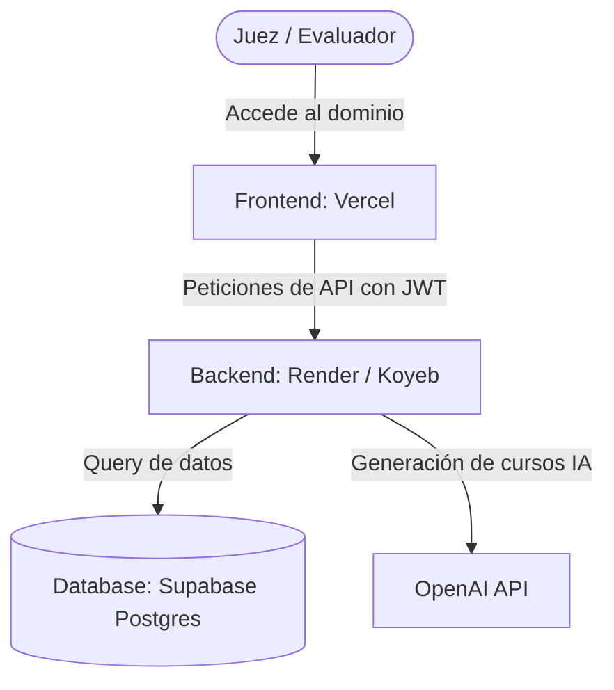

# Plan de Hosting y Despliegue para AURA

Este documento detalla la estrategia recomendada para alojar y desplegar la plataforma AURA de manera **gratuita, altamente escalable y profesional**, optimizada para la demostración ante los jueces de Sempra.

---

## 🏗️ Arquitectura de Despliegue



### Tabla Comparativa de Hosting Recomendado

| Componente | Plataforma | Plan / Costo | Ventajas | Desventajas / Detalles |
| :--- | :--- | :--- | :--- | :--- |
| **Frontend** | **Vercel** (o Cloudflare Pages) | Hobby ($0 / mes) | - Despliegues automáticos con GitHub.<br>- Carga ultrarrápida (Edge CDN).<br>- Certificado SSL y dominio personalizado gratis. | Ninguna significativa para este flujo. |
| **Backend** | **Koyeb** (Alternativa: **Render**) | Free ($0 / mes) | - **Koyeb**: Instancia activa 24/7 sin retardo de encendido.<br>- **Render**: Extremadamente fácil de configurar. | - **Render**: Se apaga tras 15 minutos sin uso (el primer request tarda ~50s). |
| **Base de Datos** | **Supabase** | Free ($0 / mes) | - Ya configurada.<br>- Postgres robusto y rápido.<br>- Pool de conexiones integrado (PgBouncer). | Ninguna, ya está lista. |

---

## 1. Despliegue del Frontend (Vercel)

El frontend es una Single Page Application (SPA) construida con Vite. 

### Pasos para Desplegar:
1. Ve a [Vercel](https://vercel.com) e inicia sesión con tu cuenta de GitHub.
2. Haz clic en **Add New** > **Project** y selecciona el repositorio de AURA.
3. Configura la carpeta raíz como: `frontend` (Root Directory).
4. Configura el comando de build y directorio de salida:
   * **Framework Preset**: Vite
   * **Build Command**: `npm run build`
   * **Output Directory**: `dist`
5. Agrega las **Variables de Entorno (Environment Variables)**:
   * `VITE_SUPABASE_URL`: Tu URL de Supabase.
   * `VITE_SUPABASE_ANON_KEY`: Tu Anon Key de Supabase.
   * `VITE_AURA_BACKEND_URL`: URL del backend desplegado (la obtendrás en el paso 2).
   * `VITE_DEMO_MODE`: `true`
6. Haz clic en **Deploy**.

> [!IMPORTANT]
> **Soporte para Rutas Dinámicas (SPA Fallback)**:
> Para evitar que al recargar la página en una ruta interna (como `/dashboard` o `/login`) la plataforma devuelva un error 404, crea un archivo llamado `vercel.json` en la raíz de la carpeta `frontend/` con el siguiente contenido antes de hacer deploy:
> ```json
> {
>   "rewrites": [
>     { "source": "/(.*)", "destination": "/index.html" }
>   ]
> }
> ```

---

## 2. Despliegue del Backend (Render / Koyeb)

Para el backend Express con Prisma, utilizaremos Render por su sencillez, o Koyeb para evitar que la aplicación se "duerma".

### Opción A: Configuración en Render (Sin Docker)
1. Inicia sesión en [Render](https://render.com) usando GitHub.
2. Crea un **New Web Service** y conecta tu repositorio.
3. Configura los parámetros:
   * **Root Directory**: `backend`
   * **Runtime**: `Node`
   * **Build Command**: `npm install && npm run build`
   * **Start Command**: `npm start`
4. Agrega las Variables de Entorno en la pestaña **Environment**:
   * `DATABASE_URL`: URL de la base de datos (con bouncer `6543`).
   * `DIRECT_URL`: URL directa de base de datos (`5432`).
   * `SUPABASE_URL`: Tu URL de Supabase.
   * `SUPABASE_SERVICE_ROLE_KEY`: Tu Service Role Key.
   * `OPENAI_API_KEY`: Tu API Key de OpenAI.
   * `DEMO_MODE`: `true`
5. Guarda y haz deploy.

### Opción B: Configuración Profesional con Docker (Altamente Recomendado)
Si prefieres asegurar que todo funcione en un entorno cerrado idéntico al de desarrollo, puedes usar Docker. **Tanto Render como Koyeb detectan el archivo `Dockerfile` automáticamente**.

Crea un archivo `backend/Dockerfile`:
```dockerfile
# backend/Dockerfile
FROM node:20-alpine

WORKDIR /app

# Instalar dependencias
COPY package*.json ./
RUN npm ci

# Copiar código y esquema de Prisma
COPY prisma ./prisma/
COPY src ./src/
COPY tsconfig.json ./

# Generar cliente de Prisma y compilar TypeScript
RUN npx prisma generate
RUN npm run build

# Exponer el puerto
EXPOSE 4000

# Variables de entorno por defecto
ENV PORT=4000
ENV NODE_ENV=production

# Comando de inicio
CMD ["npm", "start"]
```

#### Ventajas de Docker:
- No tienes que preocuparte por configurar la versión correcta de Node en la nube.
- La siembra y generación del cliente Prisma ocurren de forma aislada y limpia.
- Si en el futuro quieres migrar a AWS, Google Cloud o Railway, el contenedor Docker funcionará de manera idéntica al instante.

---

## 🔒 Seguridad en Producción

> [!WARNING]
> **Doble Llave del Modo Demo**:
> - En Vercel, si configuras `VITE_DEMO_MODE=false`, el widget flotante de selección de roles desaparecerá por completo en el frontend.
> - En el Backend, si configuras `DEMO_MODE=false`, cualquier petición que intente usar la cabecera `X-Demo-Override-Role` será ignorada por completo, operando bajo las credenciales OAuth estrictas del token JWT.
